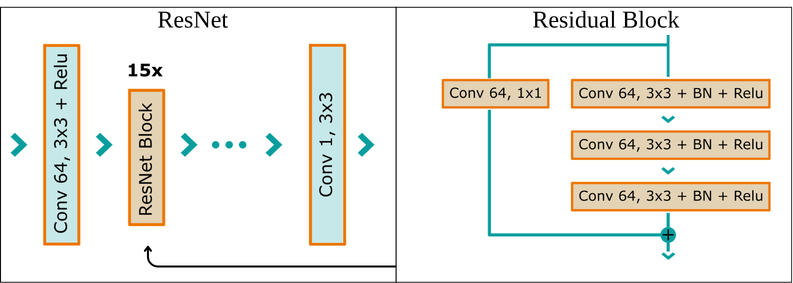
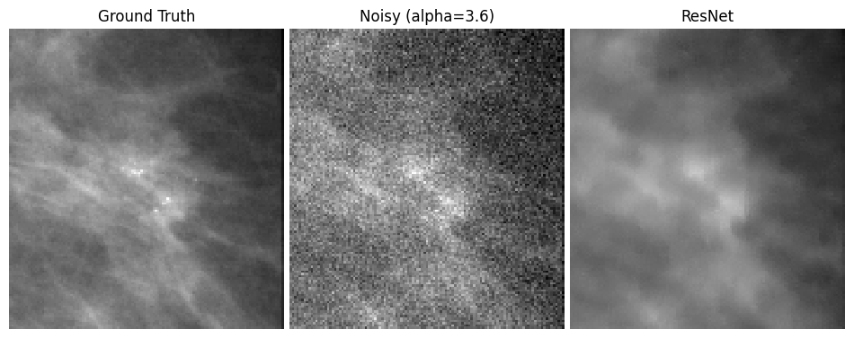
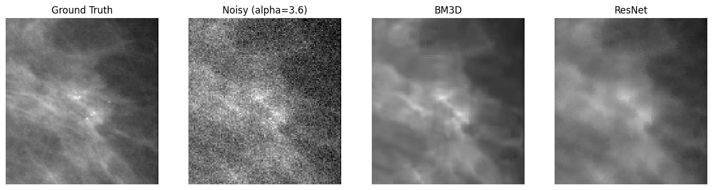

# Context and Introduction

This work aims to improve mammograms quality, using ML methods. It has been done after reading the following article: "Deep learning-based denoising of mammographic images using physics-driven data augmentation", written by the Pattern recognition lab of Friedrich-Alexander-Universität, together with Siemens Healthcare's mammography R\&D. 

This model has been trained on the well known MIAS (Mammographic Image Analysis Society) dataset.

## The problem

Breast cancer is the most commonly diagnosed cancer among women: according to the WHO, it ranked first in 157 of 185 countries in 2022, and caused an estimated 670,000 deaths worldwide that year.

This mortality rate decreased over the past few decades because of strategies such as early detection through regular screening. This involves routine mammography beyond a certain age (e.g. after 50 years old in average in France).

### Mammography: a quick explanation

Mammography is a specialized medical imaging procedure using a low dose of X-rays to allow radiologists examining the human breast. 

The breast is placed onto a flat support plate, and a parallel plate (compression paddle) presses down the tissue. Both plates are made of materials that X-rays cross easily. Compression of the breast is important, because it reduces the thickness of tissue the X-rays must cross, so fewer photons are absorbed (lower dose) or scattered with a probability that depends on the tissue. It also spreads overlapping structures apart, and it keeps the breast still during the exposure.

The produced X-rays are coming out from a focal spot (approx 0.1-0.3mm length), which can be considered as a point source, since it's size is tiny compared to distances involved. During their travel, photons can be absorbed by the breast tissues, and a fraction of these end up being absorbed by the detector.

The resulting image, called *mammogram*, is a central projection with the focal spot as center, on a plane which is the screen. Each pixel $z$ receive an amount of energy carried by incoming photons, therefore their value depend on the arrival rate $\lambda(z)$ of each photons.

## Noise in medical imaging
Noise is defined by random fluctuations around the expected value that alter the true measurement (e.g. pixels in the case of images).

Because of the nature of the material and methods used for the different imaging methods, sources of noise, and by the same way, their nature, can vary.

In the case of mammography, which relies on X-ray photons, it is in particular affected by Poisson noise.
Indeed, because the photons arrives at random times, the uncertainty on the received signal can be modeled as a Poisson distribution:
$$
P(z|\lambda) = \frac{\lambda^z e^{-\lambda}}{z!}
$$

The noisy image $Y$ received by the detector can be decomposed the following way:
$$
Y = \mu (Y) + V
$$
where:
- $\mu (Y)$: Expected image (noise free)
- $V$: Additional noise

Notice that the higher $\lambda$ is, the less noisy the image is, but the more the dose is high. The purpose of this work is to keep an exploitable image, with the lowest dose of X-rays as possible.

## The approach to solve the problem

## Results
In order to evaluate the model performances, we computed the standard metrics for denoising tasks: the PSNR (Peak Signal-to-Noise Ratio) to evaluate the quality of the output image. It is defined by:

$$
\text{PSNR} = 10 \cdot \log_{10}\left(\frac{\text{MAX}^2}{\text{MSE}}\right)
$$
where:
- $MAX$: largest possible pixel value
- $MSE$ is the mean squared error between the generated image and the original

We obtained an average PSNR of 50.42 on the test set (while noisy image had an average of 39.19 dB), the model improves the PSNR by 11.23 dB. By the same way, we obtained a SSIM of 0.990 (0.891 for noisy images), which shows a gain of 0.099.

PSNR is computed on the Anscombe domain.

We can deduce our model is indeed able to denoise a given image.

### Limitations
the PSNR and SSIM are averages over all pixels. Which means that a denoising method that smooth the image and erase meaningful details won't be penalized as we would like to. 

To show visually show the limitation of these metrics, here is an example of denoising on microcalcifications

Our model is actually oversmoothing the noisy input: microcalcifications and other structures are lost. This limitation is critical, since smoothing these crucial informations for diagnosis can lead to serious consequences for the patient. Therefore, this is a major challenge we are facing in image quality improvement in medical imaging.

### Comparison with another method: BM3D
BM3D (Block Matching and 3D Filtering) is a deterministic, non-learned algorithm commonly used for noise reduction. It is a collaborative filtering process.

| Method | PSNR (dB) | Gain (dB) | SSIM |
|---|---|---|---|
| Noisy | 39.19 | – | 0.891 |
| BM3D | **51.40** | **+12.21** | **0.991** |
| ResNet | 50.42 | +11.23 | 0.990 |

BM3D outperforms the ResNet by about 1dB. Unlike the reference article where the ResNet is the most efficient algorithm, our network doesn't for several reasons: 
- The network has been trained on less data: the exact model used is trained for 95 epoch, with one random patch per image per epoch, which appxoximatively represents $\text{nb of batches per epoch} \times \text{nb of epoch} = 15 \times 95 = 1425$ steps in the optimizer. In comparison, the article has trained its model on around 40 000 images per epoch, with 125 epochs.
- The nature of our dataset makes the simulated noise less accurate, and contain wide plain uninteresting areas. This led us, in addition of memory purposes, to consider random patches over areas with a minimum amount of photons to draft the more interesting areas (human breast tissues. This simulated noise varies between each patches, because we estimated $k$ on each patches. All of these reasons made the training more difficult.

Training the model for more epochs and improbing the data quality would then be the most efficient measures to take, even tought it is still possible to optimize more the training.

## Sources
- Deep learning-based denoising of mammographic images using physics-driven data augmentation: https://arxiv.org/html/1912.05240v1#bib.bib4 
- Denoising Autoencoders | Deep Learning Animated (Youtube): https://www.youtube.com/watch?v=0V96wE7lY4w
- WHO Fact Sheet: Breast Cancer: https://www.knowledge-action-portal.com/en/content/who-fact-sheet-breast-cancer
- Loss Functions for Image Restoration with Neural
Networks: https://arxiv.org/pdf/1511.08861